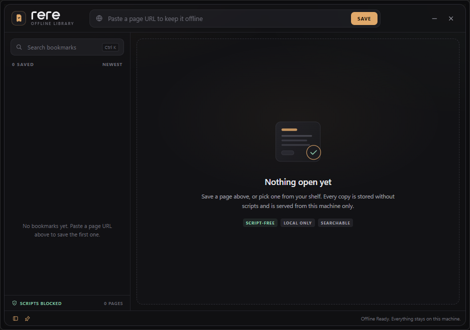

<p align="center"></p>

# win-rere

A resizable Windows desktop widget that keeps single web pages as safe, offline bookmarks. Paste a URL, save it, and read a script-free snapshot later without a network connection. The widget shows one page at a time; there are no tabs.

The UI is one WebView2 view. The archived page lives in a sandboxed iframe served from local disk through a virtual host mapping. Nothing about a saved page reaches the network when it is opened.



*The empty library. Paste a URL into the centered field; saved pages appear on the left and open in the script-free reader. The sidebar and always-on-top buttons sit in the bottom bar, with the status message on the right.*

## Using it

Run `win-rere.exe`. Drag any empty part of the top bar to move the window, or any edge or corner of the dark border to resize it. The default is the minimum width with a comfortable height, 736 x 640 logical pixels (720 px of usable content across), the minimum is 720 x 480, and the maximum is 90% of the monitor's work area, so the widget cannot take over the screen.

| What | How |
|---|---|
| Save a page | Paste a URL in the top field and press Enter or click `SAVE` |
| Open a bookmark | Click it in the left list |
| Search | Type in the search field, or press `Ctrl K` |
| Focus the URL field | `Ctrl L` |
| Hide or show the bookmark list | The panel button in the bottom left, or `Ctrl B` |
| Rename a bookmark | Hover a row, click the pencil, change the title |
| Sort the list | Click `NEWEST` to switch to A-Z |
| Open the original page online | `OPEN ORIGINAL` in the reader header |
| Delete the offline copy | `DELETE` in the reader header, then confirm |
| Keep above other windows | The pin button in the bottom left; the choice is remembered |
| Minimize / close | The two window buttons at the top right |

Only the title is editable. The URL, the saved page and its assets stay as they were archived.

Saving is asynchronous. The status bar and a thin progress line report what the archiver is doing. A newly saved page is opened automatically.

## Security model

A page downloaded from the internet is treated as hostile.

1. **URL policy.** Only `http` and `https`, only ports 80 and 443, no embedded username or password. Localhost, loopback, private, link-local, carrier-grade NAT, multicast, documentation and other reserved addresses are refused, including IPv4-mapped IPv6 forms.
2. **DNS filtering at connection time.** A custom resolver keeps only public addresses. Redirects are re-validated hop by hop, redirects from HTTPS to HTTP are refused, and the resolved peer address is checked again after connecting. Proxies are disabled so resolution cannot move to another process.
3. **Sanitization.** Scripts, iframes, objects, embeds, forms' submission attributes, event handlers, `javascript:` links, meta refresh, external stylesheets and other active content are removed or rewritten. Stylesheets and their `url()` references are parsed and every asset is downloaded locally or dropped.
4. **Strict CSP.** The saved document carries `default-src 'none'`, `script-src 'none'`, `connect-src 'none'`, `form-action 'none'`, `base-uri 'none'`, and allows images, styles and fonts only from the local content host or `data:`.
5. **Sandboxed iframe.** The reader embeds the page with `sandbox` (no scripts, forms, popups, downloads, top navigation, or same-origin access).
6. **No network while reading.** The archived page is served by a WebView2 virtual host mapping rooted at the active bookmark folder. There is no HTTP server and no DNS lookup. External link clicks are cancelled and reported in the widget.
7. **Bounded downloads.** HTML is limited to 5 MB. Each asset is limited to 8 MB, 250 assets and 40 MB per archive. Content types are checked, and common image and font formats are verified by their magic bytes. The whole job has a 120 second deadline.

WebView2's own settings are hardened too: developer tools, context menus, autofill, password save, status bar, swipe navigation and browser accelerator keys are off. Permission requests and downloads are denied, popups are blocked, and the page cannot use host objects.

What this does not do: it is not a full browser sandbox for arbitrary browsing. It is a snapshot reader. A page that depends on JavaScript for its content will look incomplete; that is the price of never executing the page's scripts.

## Where it keeps things

Bookmarks are user data and live under `%APPDATA%\win-rere`:

| Path | Contents |
|---|---|
| `bookmarks.json` | The index |
| `bookmarks\<id>.json` | Metadata for one bookmark |
| `bookmarks\<id>\index.html` | The saved page |
| `bookmarks\<id>\assets\` | Downloaded stylesheets, images, fonts |
| `window.json` | Window placement, pin state, last opened bookmark |

The WebView2 profile and `win-rere.log` live under `%LOCALAPPDATA%\win-rere`. Logs rotate at 2 MB. If `bookmarks.json` is lost, startup rebuilds it from the metadata files.

On a normal launch only `bookmarks.json` is read. The per-bookmark metadata is scanned only when the index is missing or damaged, a dirty marker was left by an interrupted change, or the number of metadata files differs from the index. Search is debounced and uses a precomputed lower-case key, so typing does not repeat that work for every bookmark.

## Limits

- Static snapshots only: no JavaScript, no forms, no video or audio elements, no iframes.
- The snapshot preserves the page's layout and CSS as far as the sanitizer can rewrite it. CSS features such as bare-string `image-set()` are not resolved.
- Public hosts only, standard web ports only.
- Pages behind a login or a paywall are saved as the unauthenticated page.
- One page is open at a time. The list remains available for switching.
- The sidebar renders at most 50 rows. When more bookmarks match, an `N more` hint under the list opens the search field; the active bookmark is kept at the top of the list even if it would fall past the cap.
- Windows 10 or 11 with the Microsoft Edge WebView2 Runtime. Windows 11 includes it; on Windows 10 it may need to be installed once.

## Logo and icon

The mark is one page held safe: a folded corner, a bookmark notch, and a check cut straight through the sheet. The wordmark is `rere`, lowercase and monoline, because the name is the repetition from reread: read, then read again. The symbol carries the offline story; the type stays quiet.

| File | Purpose |
|---|---|
| `assets/win-rere-icon.svg` | App icon master, amber mark on an ink rounded square |
| `assets/win-rere.ico` | Windows icon, 16 to 256 px, embedded in the executable |
| `assets/win-rere-symbol.svg` | Standalone mark, amber |
| `assets/win-rere-symbol-black.svg` | One-colour mark for light backgrounds |
| `assets/win-rere-symbol-white.svg` | Reversed mark for dark backgrounds |
| `assets/win-rere-wordmark.svg` | `rere` wordmark, currentColor |
| `assets/win-rere-lockup.svg` | Horizontal lockup on light |
| `assets/win-rere-lockup-dark.svg` | Horizontal lockup on dark |
| `assets/win-rere-lockup-dark.png` | README banner rendered from the dark lockup |

Palette: ink `#101012`, amber `#E0A86A`, paper `#ECECEF`. The mint `#8FD1B0` stays a UI accent, not a logo colour.

The wordmark is a monoline construction. Its strokes are kept in the app and header; expand them to outlines before using it for print, embroidery or cutting.

## Building

```
cargo build --release      # target/release/win-rere.exe
cargo test                 # unit tests for URL policy, logging, CSS and HTML sanitizing
```

`build.rs` links the prebuilt `assets/win-rere.res` into the executable. It does not run a compiler, so the build needs no Windows SDK and never executes an environment-supplied binary. The resource is generated once from `win-rere.rc` with the SDK's `rc.exe`:

```
rc /nologo /fo assets/win-rere.res win-rere.rc
```

Regenerate it after changing the icon or the version block. The build prints a warning when `win-rere.rc` or `assets/win-rere.ico` is newer than the resource. A missing resource only means the executable keeps the default icon.

The executable is about 4.5 MB. It does not bundle a browser engine; it uses the WebView2 Runtime already installed on the machine.

### Diagnostic save

`win-rere --save <url>` saves a page without opening the widget, updates the index, and sets it as the last opened bookmark. It is useful for testing the downloader and sanitizer from a terminal.

## How saving works

1. Normalize and validate the URL.
2. Fetch the HTML with the SSRF-filtered client.
3. Decode the character set, sanitize the document, and inject the CSP.
4. Fetch every referenced stylesheet, image and font into `assets/`, content-addressed by SHA-256.
5. Rewrite all active content to local paths.
6. Write `index.html`, rename the temporary folder into place, and write the metadata file.
7. Update the index and open the new bookmark.

A failure removes the temporary folder. A crash leaves `.tmp-*` folders, which are removed on the next start.

## License

The code is MIT licensed; see [LICENSE](LICENSE).
